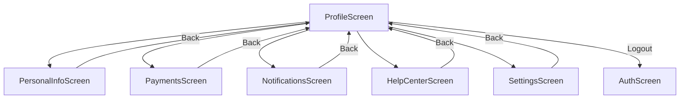
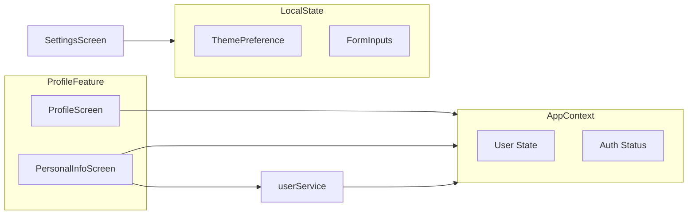

# Design Document: Profile Enhancement

## Overview

This document outlines the technical design for enhancing the Profile feature in the React Native travel application. The enhancement includes updating the existing ProfileScreen and implementing five new sub-screens: PersonalInfoScreen, PaymentsScreen, NotificationsScreen, HelpCenterScreen, and SettingsScreen.

### Design Goals

1. **Feature Isolation**: All profile-related code resides in `src/features/profile/` with its own `screens/` and `components/` directories
2. **Shared Component Reuse**: Leverage existing components from `src/components/` (Screen, Btn, Header) for consistency
3. **Design System Compliance**: Use primary color `#00BCD4` (c.p) and shared styles from `theme.ts`
4. **Navigation Integration**: Add new routes to the navigation system while maintaining backward compatibility

### Key Design Decisions

| Decision | Rationale |
|----------|-----------|
| Use native stack navigator for sub-screens | Provides platform-native transitions and proper back button handling |
| Create placeholder screens for Payments, Notifications, Help Center | Allows incremental feature rollout without blocking the main flow |
| Store theme preference in local state (future: AsyncStorage) | Simple implementation with path to persistence |
| Extend User type in store/types.ts | Centralized type definitions maintain consistency |
| Add userService for profile updates | Separates profile operations from auth service |

---

## Architecture

### Component Architecture

```
src/
├── features/
│   └── profile/
│       ├── index.ts                    # Feature barrel export
│       ├── screens/
│       │   ├── ProfileScreen.tsx       # Updated main profile screen
│       │   ├── PersonalInfoScreen.tsx  # Edit name/phone
│       │   ├── PaymentsScreen.tsx      # Placeholder
│       │   ├── NotificationsScreen.tsx # Placeholder
│       │   ├── HelpCenterScreen.tsx    # Placeholder
│       │   └── SettingsScreen.tsx      # Theme/language settings
│       └── components/
│           ├── MenuItem.tsx            # Reusable menu item component
│           ├── ProfileHeader.tsx       # Avatar + user info display
│           └── SettingRow.tsx          # Settings list row component
├── components/
│   ├── Screen.tsx                      # Shared (existing)
│   ├── Btn.tsx                         # Shared (existing)
│   └── Header.tsx                      # Shared (existing)
├── services/
│   ├── api.ts                          # Shared (existing)
│   ├── authService.ts                  # Shared (existing)
│   └── userService.ts                  # NEW: Profile update operations
└── app/navigation/
    ├── types.ts                        # Extended with profile routes
    └── RootNavigator.tsx               # Extended with profile screens
```

### Navigation Flow



### State Management



---

## Components and Interfaces

### Navigation Types

```typescript
// src/app/navigation/types.ts (extensions)

export type RootStackParamList = {
  // ... existing routes ...
  PersonalInfo: undefined;
  Payments: undefined;
  Notifications: undefined;
  HelpCenter: undefined;
  Settings: undefined;
};
```

### Service Interface

```typescript
// src/services/userService.ts

export type UpdateUserPayload = {
  name?: string;
  phone?: string;
};

export type UpdateUserResponse = {
  user: User;
};

export const userService = {
  updateProfile: (token: string, payload: UpdateUserPayload) => 
    Promise<UpdateUserResponse>;
};
```

### Component Interfaces

#### MenuItem Component

```typescript
// src/features/profile/components/MenuItem.tsx

export type MenuItemProps = {
  icon: keyof typeof Ionicons.glyphMap;
  title: string;
  onPress: () => void;
  rightElement?: React.ReactNode;
  testID?: string;
};
```

#### ProfileHeader Component

```typescript
// src/features/profile/components/ProfileHeader.tsx

export type ProfileHeaderProps = {
  name: string;
  email: string;
  phone?: string;
  favoritesCount: number;
  bookingsCount: number;
  avatarUri?: string;
};
```

#### SettingRow Component

```typescript
// src/features/profile/components/SettingRow.tsx

export type SettingRowProps = {
  label: string;
  value?: string;
  onPress?: () => void;
  type: 'navigate' | 'select' | 'toggle';
  selected?: boolean;
  disabled?: boolean;
};
```

### Screen Component Signatures

```typescript
// ProfileScreen
export function ProfileScreen({ navigation }: NativeStackScreenProps<RootStackParamList, 'Main'>): JSX.Element;

// PersonalInfoScreen
export function PersonalInfoScreen({ navigation }: NativeStackScreenProps<RootStackParamList, 'PersonalInfo'>): JSX.Element;

// PaymentsScreen
export function PaymentsScreen({ navigation }: NativeStackScreenProps<RootStackParamList, 'Payments'>): JSX.Element;

// NotificationsScreen
export function NotificationsScreen({ navigation }: NativeStackScreenProps<RootStackParamList, 'Notifications'>): JSX.Element;

// HelpCenterScreen
export function HelpCenterScreen({ navigation }: NativeStackScreenProps<RootStackParamList, 'HelpCenter'>): JSX.Element;

// SettingsScreen
export function SettingsScreen({ navigation }: NativeStackScreenProps<RootStackParamList, 'Settings'>): JSX.Element;
```

---

## Data Models

### User Model (Existing - Extended for Client)

```typescript
// src/store/types.ts

export type User = {
  id: string;
  name: string;
  email: string;
  phone?: string;
};
```

### Theme Preference Model

```typescript
// src/features/profile/types.ts

export type ThemeOption = 'light' | 'dark' | 'system';

export type SettingsState = {
  theme: ThemeOption;
  language: string;
};
```

### Form State Models

```typescript
// PersonalInfoScreen form state

type PersonalInfoFormState = {
  name: string;
  phone: string;
  isDirty: boolean;
  isSubmitting: boolean;
  errors: {
    name?: string;
    phone?: string;
  };
};
```

---

## Error Handling

### Error Categories

| Category | Handling Strategy | User Feedback |
|----------|------------------|---------------|
| Network Error | Retry button, offline message | Toast/alert with retry option |
| Validation Error | Inline field errors | Red text below field |
| Auth Error (401) | Redirect to Auth screen | Session expired message |
| Server Error (500) | Generic error message | "Something went wrong, please try again" |
| Feature Not Available | Coming soon alert | Alert dialog |

### Error Handling Implementation

```typescript
// Error handling pattern for screens

const handleError = (error: unknown, fallbackMessage: string) => {
  if (error instanceof ApiError) {
    if (error.status === 401) {
      // Token expired - sign out and redirect
      signOut();
      navigation.reset({ index: 0, routes: [{ name: 'Auth' }] });
      return;
    }
    Alert.alert('Error', error.message);
  } else {
    Alert.alert('Error', fallbackMessage);
  }
};
```

### Validation Rules

| Field | Rules | Error Message |
|-------|-------|---------------|
| name | Required, max 80 chars | "Name is required" / "Name must be 80 characters or less" |
| phone | Optional, valid phone format | "Please enter a valid phone number" |
| email | Read-only (display only) | N/A |

---

## Testing Strategy

### Test Type Assessment

This feature involves UI rendering, simple CRUD operations, and navigation. Based on the PBT assessment guidelines:

- **PBT NOT applicable**: UI rendering, simple form validation, navigation flows
- **Use example-based unit tests**: Component rendering, form validation, navigation calls
- **Use integration tests**: API calls with mocked server responses

### Unit Tests

| Component | Test Cases |
|-----------|------------|
| ProfileScreen | Renders user info, navigates to sub-screens, handles logout |
| PersonalInfoScreen | Displays current data, validates inputs, saves changes |
| PaymentsScreen | Displays placeholder, shows coming soon alert |
| NotificationsScreen | Displays disabled toggles, shows coming soon alert |
| HelpCenterScreen | Displays sections, shows coming soon alert |
| SettingsScreen | Displays options, saves theme preference locally |
| MenuItem | Renders with icon/title, calls onPress |
| ProfileHeader | Displays user info, shows counts |
| SettingRow | Renders by type, handles interactions |

### Integration Tests

| Scenario | Test Cases |
|----------|------------|
| Profile Update Flow | Successful update updates context, handles network errors |
| Auth State Changes | Guest user sees login prompt, logged-in user sees full profile |
| Navigation Flow | All screens navigate correctly, back returns to Profile |

### Test File Locations

```
src/features/profile/
├── __tests__/
│   ├── ProfileScreen.test.tsx
│   ├── PersonalInfoScreen.test.tsx
│   ├── PaymentsScreen.test.tsx
│   ├── NotificationsScreen.test.tsx
│   ├── HelpCenterScreen.test.tsx
│   └── SettingsScreen.test.tsx
└── components/
    └── __tests__/
        ├── MenuItem.test.tsx
        ├── ProfileHeader.test.tsx
        └── SettingRow.test.tsx
```

### Testing Configuration

- Use `@testing-library/react-native` for component testing
- Mock `@react-navigation/native` for navigation
- Mock `@/store/AppContext` for state management
- Mock `@/services/userService` for API calls

---

## Implementation Notes

### Backend Requirements

A new endpoint is required for profile updates:

```
PATCH /api/auth/me
Authorization: Bearer <token>
Body: { name?: string, phone?: string }
Response: { user: User }
```

**Server Implementation:**
```javascript
// server/src/routes/auth.js (addition)

router.patch('/me', auth, async (req, res) => {
  try {
    const { name, phone } = req.body || {};
    if (name !== undefined && !name.trim()) {
      return res.status(400).json({ message: 'Name cannot be empty' });
    }
    const user = await User.findByIdAndUpdate(
      req.user._id,
      { ...(name && { name: name.trim() }), ...(phone !== undefined && { phone }) },
      { new: true }
    );
    res.json({ user: user.toPublic() });
  } catch (e) {
    console.error(e);
    res.status(500).json({ message: 'Server error' });
  }
});
```

### AsyncStorage for Settings

Future implementation for persisting theme preference:

```typescript
// src/services/settingsStorage.ts

import AsyncStorage from '@react-native-async-storage/async-storage';

const THEME_KEY = '@theme_preference';

export const settingsStorage = {
  getTheme: async (): Promise<ThemeOption> => {
    const value = await AsyncStorage.getItem(THEME_KEY);
    return (value as ThemeOption) || 'system';
  },
  setTheme: async (theme: ThemeOption): Promise<void> => {
    await AsyncStorage.setItem(THEME_KEY, theme);
  },
};
```

Note: Will require installing `@react-native-async-storage/async-storage` package.

---

## Appendix

### Color Reference

| Token | Value | Usage |
|-------|-------|-------|
| c.p | #00BCD4 | Primary color - buttons, icons, highlights |
| c.pl | #C9F5FA | Primary light - avatar placeholder background |
| c.t | #1B1F27 | Text color - headings, primary text |
| c.m | #8A8F9C | Muted color - secondary text, icons |
| c.b | #DADDE4 | Border color - input borders, dividers |
| c.soft | #F3F4F6 | Soft background - cards, sections |
| c.bg | #fff | Background - screen background |

### Style Reference

| Token | Styles | Usage |
|-------|--------|-------|
| S.h1 | fontSize: 24, fontWeight: 700 | Page titles |
| S.h2 | fontSize: 18, fontWeight: 700 | Section titles |
| S.muted | color: c.m, fontSize: 14 | Secondary text |
| S.box | borderWidth: 1, borderRadius: 12, padding: 12 | Card containers |
| S.input | borderWidth: 1, borderRadius: 10, padding: 12 | Input fields |
| S.between | row, centered, space-between | Header layouts |
